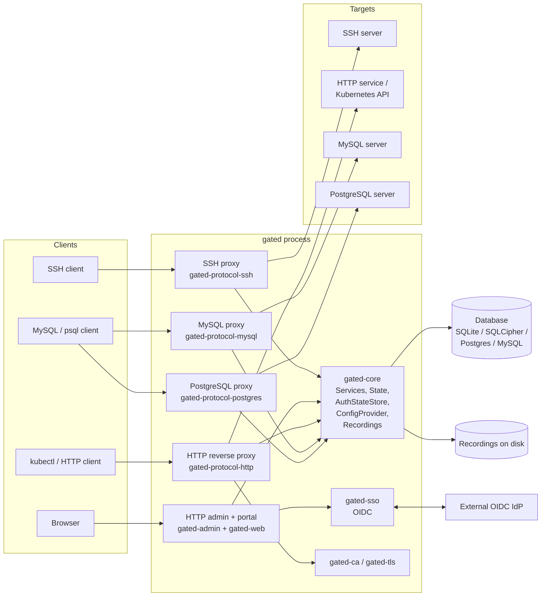

# Gated Architecture

Gated is a smart SSH, HTTP, MySQL, and PostgreSQL bastion host (a fork of
[Warpgate](https://github.com/warp-tech/warpgate)). It sits between users and
protected targets, terminates each protocol itself, authenticates the user
against its own credential store (optionally multi-factor and SSO-backed),
authorizes access through role-based checks, opens a second connection to the
real target using credentials the user never sees, and records the session.

This document set describes the **current state of the code**. It is an
as-built reference, not a design proposal.

## Document map

| Document | Covers |
|---|---|
| [protocol-ssh.md](protocol-ssh.md) | SSH proxy: listener, auth handshake, channel model, recording |
| [protocol-http.md](protocol-http.md) | HTTP reverse proxy, including the Kubernetes flavor and mTLS |
| [protocol-database.md](protocol-database.md) | MySQL and PostgreSQL proxies, shared wire-protocol crate |
| [auth.md](auth.md) | Credential types, auth state machine, SSO/OIDC, RBAC, tickets |
| [management-plane.md](management-plane.md) | Admin API, embedded web UI, user portal, CLI, config schema |
| [sessions-recordings-audit.md](sessions-recordings-audit.md) | Session registry, recordings, log entries, database layer, metrics |
| [tls-and-ca.md](tls-and-ca.md) | TLS plumbing, built-in CA, client-certificate proof-of-possession |
| [data-flows.md](data-flows.md) | End-to-end flows per protocol and trust boundaries |

## What gated is

A single Rust binary (`gated`) that:

- listens on one port per enabled protocol (SSH, HTTPS admin/portal, HTTPS
  reverse proxy, MySQL, PostgreSQL);
- holds the inventory of *users*, *roles*, *targets*, and *credentials* in its
  own database (SQLite by default, optionally SQLCipher-encrypted; PostgreSQL
  and MySQL are also supported via SeaORM);
- embeds the management web UI (a React SPA) into the binary at compile time
  (`crates/gated-web/src/lib.rs:3-5`);
- records terminal sessions, raw traffic, HTTP exchanges, and SQL statements
  to disk with metadata in the database.

## Deployment model

Gated is deployed as one process, typically:

- **Bare metal / VM**: `gated setup` (interactive) or `gated unattended-setup`
  generates `/etc/gated.yaml` (overridable via `GATED_CONFIG`,
  `crates/gated/src/main.rs:22`) plus a data directory containing the SQLite
  database (`data/db`), SSH host/client keys (`data/keys`), recordings
  (`data/recordings`), and a self-signed TLS certificate shared by all
  listeners (`crates/gated/src/commands/setup.rs`).
- **Docker**: a two-stage image (`docker/Dockerfile`) builds the web UI with
  Bun/Vite, embeds it, compiles a release binary with the `mysql,postgres`
  feature flags, and runs as a non-root `gated` user with a `/data` volume and
  `GATED_CONFIG=/data/gated.yaml`. `gated healthcheck` is the container health
  probe.
- **Static binary**: the default cargo target is `x86_64-unknown-linux-musl`
  (`.cargo/config.toml`), producing a dependency-free binary. Release builds
  disable LTO and use `panic = "abort"` (workspace `Cargo.toml`).

The `gated run` command boots every enabled component as a future in a single
`FuturesUnordered` set (`crates/gated/src/commands/run.rs:270-330`):

1. HTTP admin/portal server (always on) — `crates/gated/src/commands/run.rs:272`
2. SSH proxy (if `ssh.enable`) — `run.rs:281`
3. MySQL proxy (if `mysql.enable`) — `run.rs:291`
4. PostgreSQL proxy (if `postgres.enable`) — `run.rs:301`
5. HTTP reverse proxy (if `http.enable`) — `run.rs:314`
6. Observability listener serving `/metrics`, `/healthz`, `/readyz`
   (if `metrics.enable`) — `run.rs:326`

Background tasks handle database retention cleanup, config-file hot reload,
and systemd readiness/watchdog notification. If database encryption is
enabled but the key has not been provided yet, a minimal HTTP server is
started first that only exposes the unlock API and the SPA
(`run.rs:238`).

Default listen addresses (`crates/gated-common/src/config/defaults.rs`):

| Listener | Default |
|---|---|
| HTTP admin/portal | `[::]:8888` (defaults.rs:43-45) |
| SSH | `[::]:2222` (defaults.rs:82-84) |
| MySQL | `[::]:33306` (defaults.rs:48-50) |
| PostgreSQL | `[::]:55432` (defaults.rs:53-55) |
| HTTP reverse proxy | `http.listen` (defaults.rs:58-60) |
| Metrics/health | `127.0.0.1:9090` (defaults.rs:86-90) |

## Workspace layout

15 crates under `crates/` (workspace `Cargo.toml`):

| Crate | Role |
|---|---|
| `gated` | CLI binary: `run`, `setup`, `unattended-setup`, `check`, `create-user`, `recover-access`, `client-keys`, `healthcheck`, `encrypt-existing-db`, `version` (`crates/gated/src/main.rs:44-166`) |
| `gated-common` | Shared types: config schema, credential/auth types, target options, helpers |
| `gated-core` | Session registry, services container, auth state store, config providers (DB-backed), recordings, logging, metrics, database bootstrap |
| `gated-admin` | axum-based HTTP service: admin API, user portal API, SPA serving, web terminals |
| `gated-web` | `rust-embed` wrapper around the built `web/dist` SPA assets |
| `gated-protocol-ssh` | SSH server + outbound SSH client (russh) |
| `gated-protocol-http` | HTTPS reverse proxy with generic and Kubernetes flavors |
| `gated-protocol-mysql` | MySQL wire-protocol proxy |
| `gated-protocol-postgres` | PostgreSQL wire-protocol proxy |
| `gated-database-protocols` | Wire-level MySQL packet types (extracted from sqlx-core) |
| `gated-db-entities` | SeaORM entities (users, targets, sessions, recordings, credentials, ...) |
| `gated-db-migrations` | SeaORM migrations |
| `gated-sso` | OIDC client (openidconnect) for Google/Apple/Azure/custom providers |
| `gated-ca` | Built-in CA issuing client certificates for mTLS proof-of-possession |
| `gated-tls` | rustls helpers: cert/key loading, `MaybeTlsStream`, outbound TLS connector |

The `web/` directory holds the React 19 + TanStack Router + Vite SPA; its
`dist/` output is embedded by `gated-web` at compile time.

## Top-level component diagram

## Core runtime objects

Everything shares a cloneable `Services` struct
(`crates/gated-core/src/services.rs:58-78`):

- `db` — `Arc<RwLock<Option<DatabaseConnection>>>` (None while encrypted DB is
  locked)
- `state` — live session registry (`crates/gated-core/src/state.rs:17`)
- `config` / `config_provider` — config store and the DB-backed
  `ConfigProvider` that answers credential validation and authorization
  queries
- `auth_state_store` — in-flight multi-step authentication attempts
- `recordings` — recording writer factory
- `admin_token`, `rate_limiter_registry`, `db_pool_registry`, `metrics`,
  `global_params`, and the encryption runtime/bootstrap-token slots

Each protocol proxy implements the `ProtocolServer` trait and is handed a
clone of `Services`; the HTTP reverse proxy is the one exception and runs as a
free function (`crates/gated-protocol-http/src/server.rs:45`).

## Trust boundaries (summary)

See [data-flows.md](data-flows.md) for the full diagram. In short:

- **Client to gated** — untrusted network; every listener terminates its own
  TLS (SSH uses SSH transport crypto) and performs authentication before any
  target contact.
- **Gated to target** — gated holds the target credentials (or per-target
  bound accounts); users never receive them. Target TLS/host-key verification
  is configurable per target.
- **Gated to database** — the database stores credential hashes, ticket and
  API-token secrets, the CA private key, and session/audit metadata; it is the
  most sensitive store and supports at-rest encryption for SQLite.
- **Admin plane** — the admin API requires the built-in `admin` role
  (`crates/gated-core/src/consts.rs:1`); the user portal API only requires an
  authenticated session.
