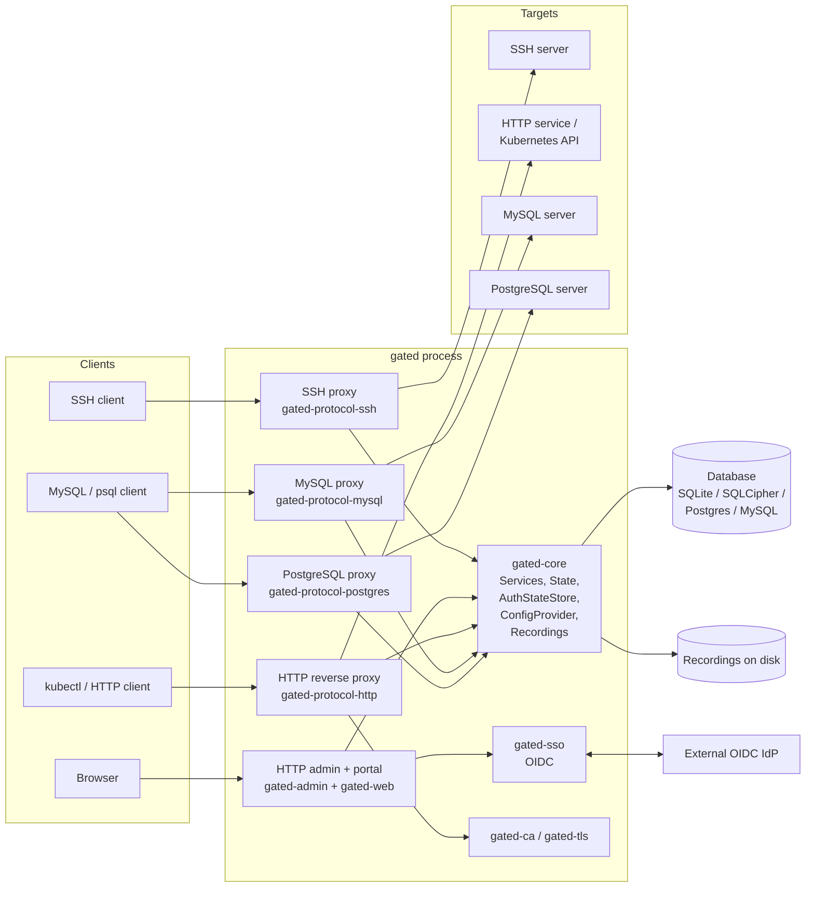

# Gated 架构

[English](README.md) | 简体中文

Gated 是一个面向 SSH、HTTP、MySQL 和 PostgreSQL 的智能堡垒机（[Warpgate](https://github.com/warp-tech/warpgate)
的分支）。它位于用户与受保护目标之间，自行终结每种协议，用自己的凭据库认证用户（可选多因素和 SSO），
通过基于角色的检查授权访问，使用用户永远看不到的凭据向真实目标建立第二条连接，并录制会话。

本组文档描述的是**代码的当前状态**。它是按实现编写的参考，不是设计提案。

## 文档地图

| 文档 | 内容 |
|---|---|
| [protocol-ssh.zh-CN.md](protocol-ssh.zh-CN.md) | SSH 代理：监听器、认证握手、通道模型、录制 |
| [protocol-http.zh-CN.md](protocol-http.zh-CN.md) | HTTP 反向代理，包括 Kubernetes 变体和 mTLS |
| [protocol-database.zh-CN.md](protocol-database.zh-CN.md) | MySQL 和 PostgreSQL 代理，共享线协议 crate |
| [auth.zh-CN.md](auth.zh-CN.md) | 凭据类型、认证状态机、SSO/OIDC、RBAC、票据 |
| [management-plane.zh-CN.md](management-plane.zh-CN.md) | 管理 API、内嵌 Web UI、用户门户、CLI、配置结构 |
| [sessions-recordings-audit.zh-CN.md](sessions-recordings-audit.zh-CN.md) | 会话注册表、录制、日志条目、数据库层、指标 |
| [tls-and-ca.zh-CN.md](tls-and-ca.zh-CN.md) | TLS 管线、内置 CA、客户端证书持有证明 |
| [data-flows.zh-CN.md](data-flows.zh-CN.md) | 各协议端到端流程与信任边界 |

## gated 是什么

一个单一的 Rust 二进制（`gated`），它：

- 为每个启用的协议监听一个端口（SSH、HTTPS 管理 / 门户、HTTPS 反向代理、MySQL、PostgreSQL）；
- 在自己的数据库中保存*用户*、*角色*、*目标*和*凭据*清单（默认 SQLite，可选 SQLCipher 加密；也通过
  SeaORM 支持 PostgreSQL 和 MySQL）；
- 在编译时把管理 Web UI（React SPA）嵌入二进制（`crates/gated-web/src/lib.rs`）；
- 把终端会话、原始流量、HTTP 交互和 SQL 语句录制到磁盘，元数据存入数据库。

## 部署模型

Gated 以单个进程部署，常见方式：

- **裸机 / 虚拟机**：`gated setup`（交互式）或 `gated unattended-setup` 写出配置和数据目录
  （`crates/gated/src/commands/setup.rs`）：SQLite 数据库（`db/`）、SSH 密钥（`ssh-keys/`）、录制
  （`recordings/`），以及所有监听器共用的自签名 TLS 证书和密钥。使用全局参数 `--data-dir <dir>`
  （`GATED_DATA_DIR`）时，配置为 `<dir>/config.yaml`，所有相对路径（包括加密状态和引导令牌）都在
  `<dir>` 内解析；否则由 `--config`（`GATED_CONFIG`，默认 `/etc/gated.yaml`）选择配置文件，相对路径
  以其所在目录解析（`crates/gated-common/src/state.rs`）。
- **Docker**：两阶段镜像（`docker/Dockerfile`）用 Bun/Vite 构建 Web UI 并嵌入，以 `mysql,postgres`
  feature 编译 release 二进制，以非 root 的 `gated` 用户运行，使用 `/data` 卷并设置
  `GATED_DATA_DIR=/data`。`gated healthcheck` 作为容器健康探针。
- **静态二进制**：默认 cargo 目标为 `x86_64-unknown-linux-musl`（`.cargo/config.toml`），产出无依赖的
  二进制。release 构建关闭 LTO 并使用 `panic = "abort"`（工作区 `Cargo.toml`）。

`gated run` 命令把每个启用的组件作为 future 放进同一个 `FuturesUnordered` 集合启动
（`crates/gated/src/commands/run.rs`）：

1. HTTP 管理 / 门户服务（始终开启）
2. SSH 代理（若 `ssh.enable`）
3. MySQL 代理（若 `mysql.enable`）
4. PostgreSQL 代理（若 `postgres.enable`）
5. HTTP 反向代理（若 `http.enable`）
6. 提供 `/metrics`、`/healthz`、`/readyz` 的可观测性监听器（若 `metrics.enable`）

后台任务负责数据库保留期清理、配置文件热加载以及 systemd 就绪 / watchdog 通知。如果启用了数据库加密但
尚未提供密钥，会先启动一个最小 HTTP 服务，只暴露解锁 API 和 SPA。

默认监听地址（`crates/gated-common/src/config/defaults.rs`）：

| 监听器 | 默认值 |
|---|---|
| HTTP 管理 / 门户 | `[::]:8888` |
| SSH | `[::]:2222` |
| MySQL | `[::]:33306` |
| PostgreSQL | `[::]:55432` |
| HTTP 反向代理 | `[::]:8443` |
| 指标 / 健康检查 | `127.0.0.1:9090` |

## 工作区结构

`crates/` 下 15 个 crate（工作区 `Cargo.toml`）：

| Crate | 职责 |
|---|---|
| `gated` | CLI 二进制：`run`、`setup`、`unattended-setup`、`check`、`create-user`、`recover-access`、`client-keys`、`healthcheck`、`encrypt-existing-db`、`version`（`crates/gated/src/main.rs`） |
| `gated-common` | 共享类型：配置结构、凭据 / 认证类型、目标选项、辅助函数 |
| `gated-core` | 会话注册表、服务容器、认证状态存储、配置提供者（基于数据库）、录制、日志、指标、数据库引导 |
| `gated-admin` | 基于 axum 的 HTTP 服务：管理 API、用户门户 API、SPA 托管、Web 终端 |
| `gated-web` | 对构建出的 `web/dist` SPA 资源的 `rust-embed` 封装 |
| `gated-protocol-ssh` | SSH 服务端 + 出站 SSH 客户端（russh） |
| `gated-protocol-http` | 带通用和 Kubernetes 变体的 HTTPS 反向代理 |
| `gated-protocol-mysql` | MySQL 线协议代理 |
| `gated-protocol-postgres` | PostgreSQL 线协议代理 |
| `gated-database-protocols` | 线级 MySQL 数据包类型（从 sqlx-core 提取） |
| `gated-db-entities` | SeaORM 实体（用户、目标、会话、录制、凭据……） |
| `gated-db-migrations` | SeaORM 迁移 |
| `gated-sso` | 面向 Google/Apple/Azure/自定义提供者的 OIDC 客户端（openidconnect） |
| `gated-ca` | 为 mTLS 持有证明签发客户端证书的内置 CA |
| `gated-tls` | rustls 辅助：证书 / 密钥加载、`MaybeTlsStream`、出站 TLS 连接器 |

`web/` 目录是 React 19 + TanStack Router + Vite 的 SPA；其 `dist/` 输出在编译时由 `gated-web` 嵌入。

## 顶层组件图

## 核心运行时对象

所有组件共享一个可克隆的 `Services` 结构（`crates/gated-core/src/services.rs`）：

- `db` —— `Arc<RwLock<Option<DatabaseConnection>>>`（加密数据库锁定时为 None）
- `state` —— 实时会话注册表（`crates/gated-core/src/state.rs`）
- `config` / `config_provider` —— 配置存储，以及负责凭据校验和授权查询的、基于数据库的 `ConfigProvider`
- `auth_state_store` —— 进行中的多步认证尝试
- `recordings` —— 录制写入器工厂
- `admin_token`、`rate_limiter_registry`、`db_pool_registry`、`metrics`、`global_params`，以及加密运行时 /
  引导令牌槽位

每个协议代理实现 `ProtocolServer` trait，并持有一份 `Services` 的克隆；唯一的例外是 HTTP 反向代理，它以
自由函数运行（`crates/gated-protocol-http/src/server.rs`）。

## 信任边界（摘要）

完整图示见 [data-flows.zh-CN.md](data-flows.zh-CN.md)。简而言之：

- **客户端到 gated** —— 不可信网络；每个监听器自行终结 TLS（SSH 使用 SSH 传输加密），并在接触任何目标
  之前完成认证。
- **gated 到目标** —— gated 持有目标凭据（或每目标绑定的账户）；用户永远拿不到它们。目标的 TLS / 主机
  密钥验证可按目标配置。
- **gated 到数据库** —— 数据库存储凭据哈希、票据和 API 令牌密钥、CA 私钥以及会话 / 审计元数据；它是最
  敏感的存储，SQLite 支持静态加密。
- **管理面** —— 管理 API 需要内置的 `admin` 角色（`crates/gated-core/src/consts.rs`）；用户门户 API 只需要
  已认证的会话。
