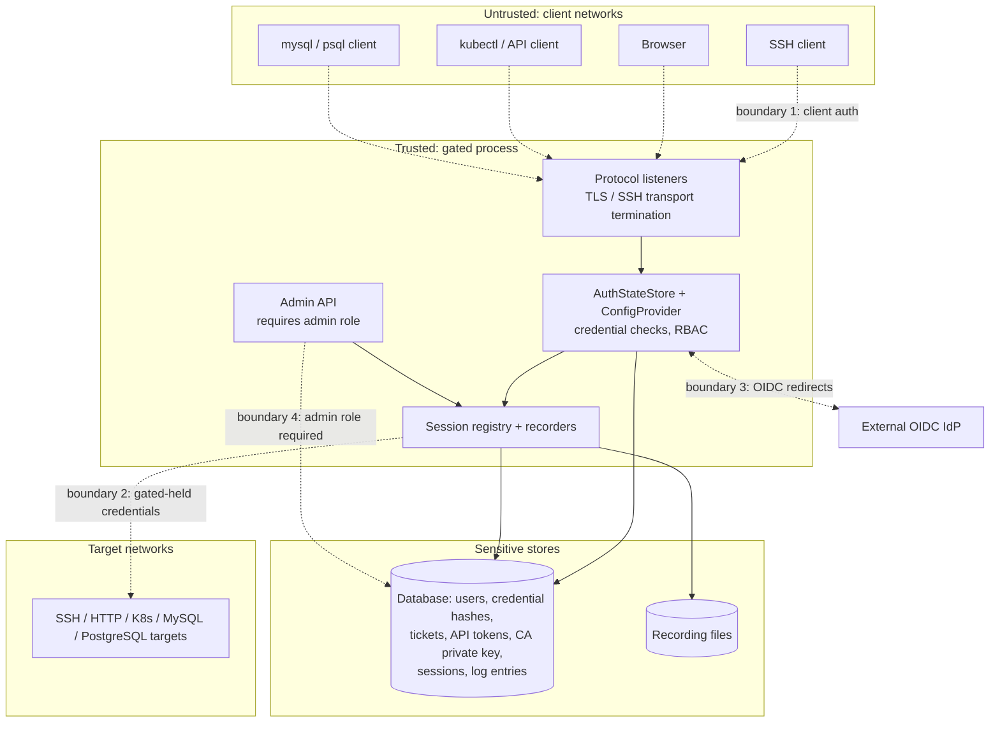

# Data Flows and Trust Boundaries

English | [简体中文](data-flows.zh-CN.md)

## Trust boundary diagram



Boundary properties:

1. **Client to gated** — every listener authenticates before any target
   contact. SSH uses SSH transport security; the HTTP listeners, MySQL, and
   (when negotiated) PostgreSQL use rustls. MySQL refuses non-TLS clients
   outright.
2. **Gated to target** — target credentials (passwords, keys, tokens, bound
   accounts) are stored on the gated side and injected into the outbound
   leg; the user never observes them. Outbound verification (SSH host keys,
   TLS certificate checks) is configurable per target.
3. **Gated to IdP** — only OIDC authorization-code flows with PKCE/nonce;
   gated never sees IdP passwords.
4. **User plane vs admin plane** — the portal API exposes only the caller's
   own resources and authorized targets; mutation of inventory requires the
   built-in `admin` role.
5. **Gated to its stores** — the database holds Argon2 password hashes and
   ticket/API-token digests, but also the target and account credentials and
   the CA private key; the database and recording directory are therefore as
   sensitive as the bastion itself (SQLite supports at-rest encryption).

## End-to-end flows

### SSH

```
ssh alice:prod-box@gated -p 2222
```

1. TCP accept; session registered in `State`; russh handshake with gated's
   host key (`crates/gated-protocol-ssh/src/server/mod.rs`).
2. Username parsed by `AuthSelector` into user `alice`, target `prod-box`
   (`crates/gated-common/src/auth/selector.rs`).
3. Credentials collected (publickey/password/keyboard-interactive OTP or web
   approval) until the user's policy is satisfied; then
   `authorize_target` RBAC check.
4. First shell/exec/forward request triggers the lazy outbound connection;
   gated authenticates with target-configured credentials or its client
   keys, verifying the target host key against known hosts.
5. Channels bridge one-to-one; terminal recorders capture shell I/O, traffic
   recorders capture forwarded TCP as PCAP; on disconnect the session row is
   closed.

### HTTP (generic and Kubernetes)

```
curl https://grafana.proxy.example.com/...      (Host-based routing)
kubectl --server https://gated:8443 ...         (X-Gated-Target or base domain)
```

1. TLS handshake on the proxy listener; an optional client certificate is
   captured.
2. Target resolved from `X-Gated-Target` or `<target>.<base_domain>`
   (`crates/gated-protocol-http/src/resolver.rs`).
3. Authentication: API token (Bearer header or `?gated-token=`) or the
   captured client certificate matched against issued
   `CertificateCredential`s; then `authorize_target`.
4. Session resolved: per-request (generic) or correlated per
   user/target/IP (Kubernetes).
5. The request is rebuilt against the target base URL, stripped of gated
   headers, and sent with the target's upstream auth (headers, bearer
   token, or mTLS identity); responses stream for watches/chunked replies,
   otherwise buffer up to 100 MiB.
6. Each exchange is appended to the HTTP recording and logged; kubectl
   exec/attach websockets are bridged and terminal-recorded.

### MySQL

```
mysql -h gated -P 33306 -u alice#appdb --ssl ...
```

1. Gated sends a handshake advertising SSL; the client must upgrade to TLS
   or is rejected (`crates/gated-protocol-mysql/src/session.rs`).
2. Username `alice#appdb` selects user and target; the client is switched to
   clear-password auth (inside TLS) and the password is verified; policy +
   RBAC checks follow.
3. Gated connects to the real MySQL server with the target's (or bound
   account's) credentials, honoring `tls.mode`/`tls.verify`, negotiating
   whatever auth plugin the server demands.
4. Packets relay; each `COM_QUERY` is decoded, timed, classified, and
   written to the SQL audit recording with success/error status.

### PostgreSQL

```
psql "host=gated port=55432 user=alice#appdb sslmode=require dbname=app"
```

1. Optional `SSLRequest` upgrade, then the startup message supplies the
   selector username and database.
2. Cleartext password (or web approval) collected and verified; policy +
   RBAC checks.
3. Outbound connection authenticates via cleartext/MD5/SCRAM per the
   server's demand, honoring `tls.mode`/`tls.verify`.
4. Extended-protocol messages relay; `Parse`/`Bind`/`Execute`/`Query` are
   tracked so each executed statement (including prepared ones) lands in
   the SQL audit recording; idle sessions time out.

### Web portal (control flow)

1. Browser loads `/ui` (embedded SPA) and logs in via `/api/auth/*`
   (password, then OTP/SSO/web approval as required); a `gated-http-session`
   cookie is issued.
2. The portal lists authorized targets, offers web terminals (SSH, MySQL
   and PostgreSQL over WebSockets), the SQL console, the file manager,
   credential self-service, API tokens, and tickets.
3. Admins additionally manage inventory and watch live sessions; closing a
   session calls `SessionHandle::close()` on the live connection
   (`crates/gated-admin/src/api/sessions_detail.rs`).
