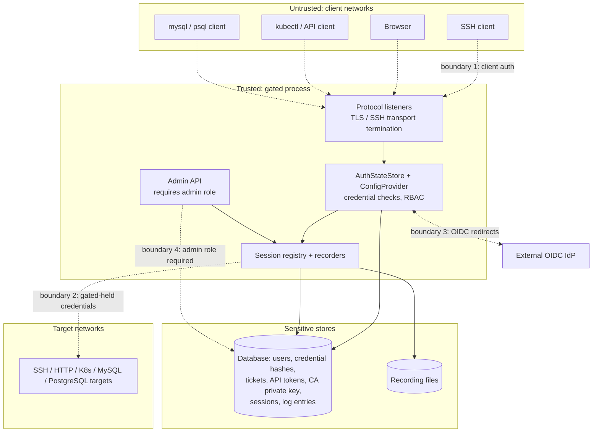

# 数据流与信任边界

[English](data-flows.md) | 简体中文

## 信任边界图



边界特性：

1. **客户端到 gated** —— 每个监听器在接触任何目标之前完成认证。SSH 使用 SSH 传输安全；HTTP 监听器、
   MySQL 以及（协商时的）PostgreSQL 使用 rustls。MySQL 直接拒绝非 TLS 客户端。
2. **gated 到目标** —— 目标凭据（密码、密钥、令牌、绑定账户）保存在 gated 一侧，并注入到出站连接中；用户
   永远看不到它们。出站验证（SSH 主机密钥、TLS 证书检查）可按目标配置。
3. **gated 到 IdP** —— 只使用带 PKCE/nonce 的 OIDC 授权码流程；gated 永远看不到 IdP 密码。
4. **用户面与管理面** —— 门户 API 只暴露调用者自己的资源和有权访问的目标；修改清单需要内置的 `admin` 角色。
5. **gated 到其存储** —— 数据库保存 Argon2 密码哈希和票据 / API 令牌摘要，但也保存目标和账户凭据以及 CA
   私钥；因此数据库和录制目录与堡垒机本身同样敏感（SQLite 支持静态加密）。

## 端到端流程

### SSH

```
ssh alice:prod-box@gated -p 2222
```

1. 接受 TCP 连接；在 `State` 中登记会话；用 gated 的主机密钥完成 russh 握手
   （`crates/gated-protocol-ssh/src/server/mod.rs`）。
2. `AuthSelector` 把用户名解析为用户 `alice`、目标 `prod-box`（`crates/gated-common/src/auth/selector.rs`）。
3. 收集凭据（publickey / password / keyboard-interactive OTP 或网页批准），直到满足用户的策略；然后执行
   `authorize_target` RBAC 检查。
4. 第一个 shell / exec / 转发请求触发延迟建立的出站连接；gated 用目标配置的凭据或自己的客户端密钥认证，并
   对照 known hosts 验证目标主机密钥。
5. 通道一一桥接；终端录制器记录 shell I/O，流量录制器把转发的 TCP 记录为 PCAP；断开时关闭会话行。

### HTTP（通用与 Kubernetes）

```
curl https://grafana.proxy.example.com/...      (Host-based routing)
kubectl --server https://gated:8443 ...         (X-Gated-Target or base domain)
```

1. 在代理监听器上完成 TLS 握手；捕获可选的客户端证书。
2. 从 `X-Gated-Target` 或 `<target>.<base_domain>` 解析目标（`crates/gated-protocol-http/src/resolver.rs`）。
3. 认证：API 令牌（Bearer 头或 `?gated-token=`），或把捕获的客户端证书与已签发的 `CertificateCredential` 匹配；然后
   `authorize_target`。
4. 确定会话：每个请求一个（通用），或按用户 / 目标 / IP 关联（Kubernetes）。
5. 请求按目标基础 URL 重建，去掉 gated 头，并带上目标的上游认证（请求头、bearer 令牌或 mTLS 身份）发送；
   watch / 分块响应以流式返回，其余最多缓冲 100 MiB。
6. 每次交互追加到 HTTP 录制并写日志；kubectl exec/attach 的 websocket 被桥接并做终端录制。

### MySQL

```
mysql -h gated -P 33306 -u alice#appdb --ssl ...
```

1. gated 发送声明支持 SSL 的握手；客户端必须升级到 TLS，否则被拒绝（`crates/gated-protocol-mysql/src/session.rs`）。
2. 用户名 `alice#appdb` 选择用户和目标；客户端被切换到明文密码认证（在 TLS 内）并校验密码；随后进行策略 +
   RBAC 检查。
3. gated 用目标（或绑定账户）的凭据连接真实的 MySQL 服务器，遵循 `tls.mode`/`tls.verify`，并协商服务器
   要求的认证插件。
4. 转发数据包；每个 `COM_QUERY` 被解码、计时、分类，并连同成功 / 错误状态写入 SQL 审计录制。

### PostgreSQL

```
psql "host=gated port=55432 user=alice#appdb sslmode=require dbname=app"
```

1. 可选的 `SSLRequest` 升级，然后启动消息提供选择器用户名和数据库。
2. 收集并校验明文密码（或网页批准）；策略 + RBAC 检查。
3. 出站连接按服务器要求使用 cleartext / MD5 / SCRAM 认证，遵循 `tls.mode`/`tls.verify`。
4. 转发扩展协议消息；跟踪 `Parse`/`Bind`/`Execute`/`Query`，使每条执行的语句（包括预处理语句）进入 SQL
   审计录制；空闲会话会超时。

### Web 门户（控制流）

1. 浏览器加载 `/ui`（内嵌 SPA），通过 `/api/auth/*` 登录（先密码，再按需 OTP / SSO / 网页批准）；签发
   `gated-http-session` cookie。
2. 门户列出有权访问的目标，提供 Web 终端（SSH、MySQL 和 PostgreSQL，基于 WebSocket）、SQL 控制台、文件
   管理器、凭据自助管理、API 令牌和票据。
3. 管理员还能管理清单并查看实时会话；关闭会话会对实时连接调用 `SessionHandle::close()`
   （`crates/gated-admin/src/api/sessions_detail.rs`）。
